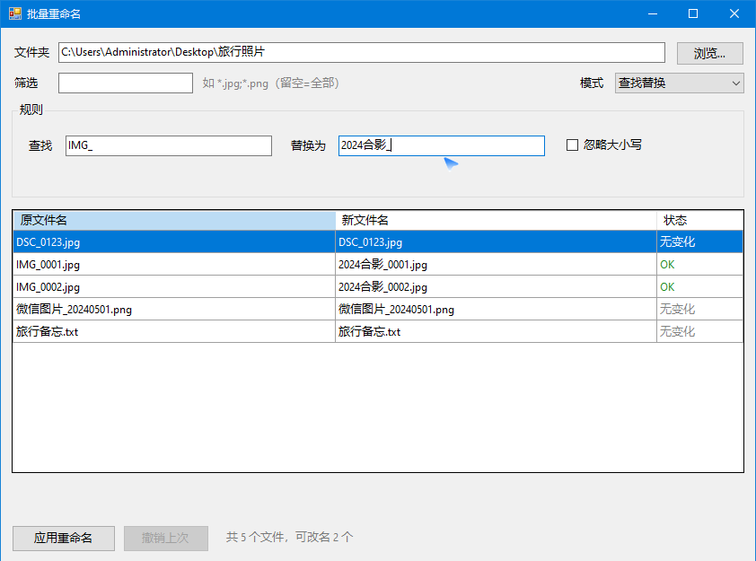

# BatchRenamer

一个 50 KB 的 Windows 批量重命名小工具：先预览、再改名、随时撤销。
原生 WinForm（.NET Framework 4.8），双击 exe 即用，无第三方依赖、不写注册表。



## 五种规则

| 规则 | 说明 |
| --- | --- |
| 查找替换 | 把文件名里的指定文字换成别的（可选忽略大小写） |
| 添加前后缀 | 统一加前缀 / 后缀，后缀默认加在扩展名之前 |
| 编号重命名 | 自定义基名、起始序号、位数，如 `file001`、`file002` |
| 正则替换 | 用正则表达式改写文件名 |
| 大小写转换 | 全部大写 / 全部小写 / 首字母大写 |

## 特点

- 选目录后**即时预览**「原文件名 → 新文件名」，每行都带状态
- 提交前做完整检查：重复命名标记 `冲突`，目标已存在标记 `已存在`，另有 `非法字符`、`空名称`、`正则错误`；只对状态 `OK` 的行执行
- **两阶段改名**：先把所有文件改成临时名，再改成目标名，所以天生支持 `A ↔ B` 互换；中途失败自动回滚，不会留下半成品
- **「撤销上次」**按记录一键还原上一次改名结果
- 支持按扩展名筛选，如 `*.jpg;*.png`，留空则处理全部文件
- 改名之前会弹窗确认，并提示可以撤销

## 数据位置

```
%AppData%\BatchRenamer\
  settings.ini     记住上次使用的文件夹
  last_rename.tsv  上一次改名的记录（用于撤销）
```

## 运行

从 [Releases](../../releases) 下载 exe，双击即可。
首次运行 Windows SmartScreen 可能提示「未知发布者」，点「更多信息 → 仍要运行」。

## 自行编译

需要 .NET Framework 4.8 引用程序集（安装 Visual Studio 2022 即自带）。

```bash
git clone https://github.com/MYY114/BatchRenamer.git
cd BatchRenamer
dotnet build -c Release
```

产物在 `bin\Release\net48\BatchRenamer.exe`。
`MainForm.Designer.cs` 是标准设计器代码，可直接用 Visual Studio 窗体设计器修改界面。

## 已知限制

- 只处理所选目录下的文件，不递归子目录
- 只重命名文件，不处理文件夹
- 仅支持 Windows

## License

[MIT](LICENSE)
